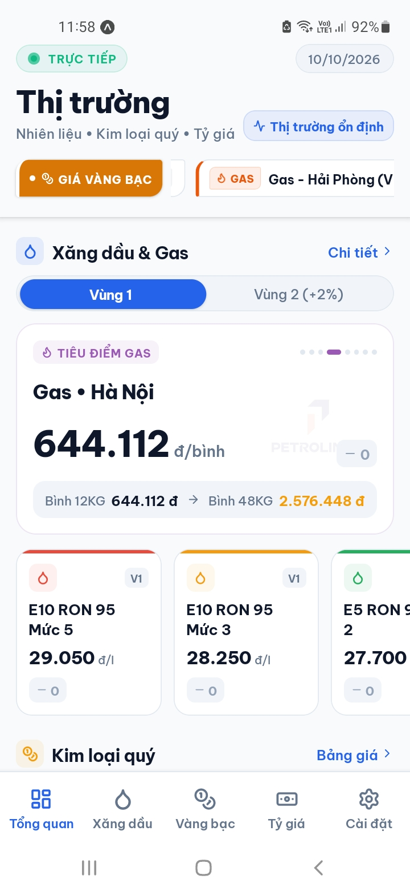
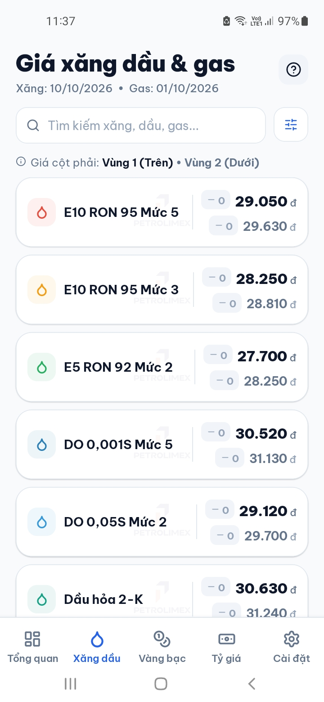
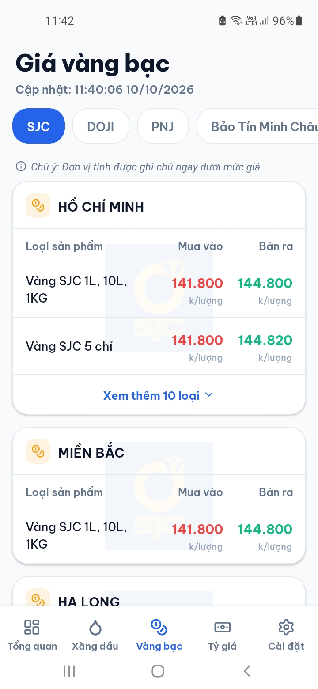
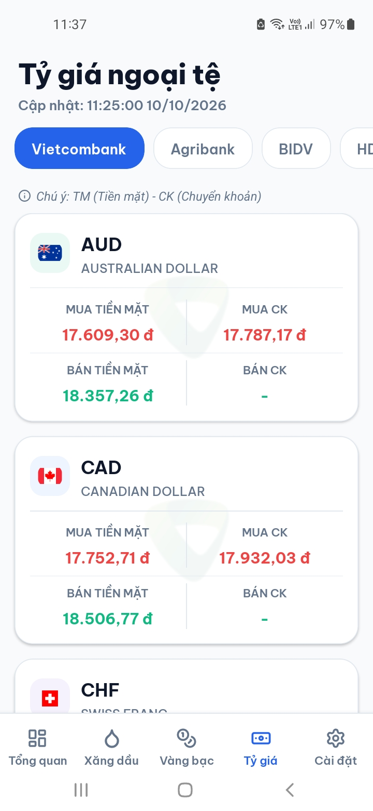
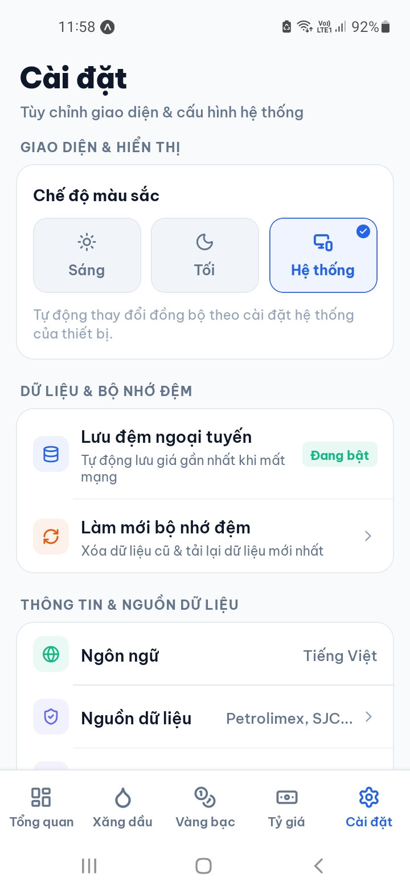

<div align="center">

  

  <h1>Market App - Vietnam Market Tracker & Real-Time Price Hub</h1>
  <h3>Hệ thống Theo dõi & Cập nhật Giá cả Thị trường, Xăng dầu Petrolimex, Vàng bạc Kim loại quý & Tỷ giá Ngoại tệ Thời gian Thực</h3>

  <p>
    Ứng dụng di động đa nền tảng (Android & iOS) phục vụ người tiêu dùng và nhà đầu tư: 
    Cập nhật trực tiếp giá xăng dầu & khí đốt LPG từ Petrolimex, biến động giá vàng miếng & bạc Phú Quý 999 từ các thương hiệu lớn, 
    cùng bảng tỷ giá ngoại tệ đa ngân hàng thương mại với cơ chế lưu đệm Offline-First thông minh.
  </p>

  <p>
    
    
    
    
    
    
    
  </p>

</div>

<br />

# MOBILE APPLICATION & VIETNAM MARKET PRICE HUB

Đây là kho lưu trữ chứa mã nguồn **Mobile Application** của dự án **Market App**. Ứng dụng được xây dựng trên nền tảng **React Native 0.81.5** và **Expo SDK 54** với kiến trúc **New Architecture (Fabric & TurboModules)**, đáp ứng các tiêu chuẩn thẩm mỹ hiện đại, hiệu năng 60fps và hỗ trợ đầy đủ hai nền tảng Android và iOS.

Ứng dụng đã được rà soát và nâng cấp thư viện mạng **Axios** lên phiên bản an toàn `^1.20.0` nhằm ngăn chặn các nguy cơ tấn công SSRF và Prototype Pollution.

---

## Mục lục

- [1. Công nghệ & Thư viện Cốt lõi](#1-công-nghệ--thư-viện-cốt-lõi)
  - [Nền tảng Di động Cốt lõi](#nền-tảng-di-động-cốt-lõi)
  - [Giao diện Người dùng, Kiểu chữ & Hoạt họa](#giao-diện-người-dùng-kiểu-chữ--hoạt-họa)
  - [Tầng Mạng, Bóc tách Dữ liệu & Lưu đệm Ngoại tuyến](#tầng-mạng-bóc-tách-dữ-liệu--lưu-đệm-ngoại-tuyến)
- [2. Tính năng Giao diện & Kiến trúc Trải nghiệm Người dùng](#2-tính-năng-giao-diện--kiến-trúc-trải-nghiệm-người-dùng)
  - [2.1. Màn hình Tổng quan Thị trường (Dashboard)](#21-màn-hình-tổng-quan-thị-trường-dashboard)
  - [2.2. Màn hình Xăng dầu & Khí đốt LPG (GasPriceScreen)](#22-màn-hình-xăng-dầu--khí-đốt-lpg-gaspricescreen)
  - [2.3. Màn hình Vàng bạc & Kim loại quý (GoldPriceScreen)](#23-màn-hình-vàng-bạc--kim-loại-quý-goldpricescreen)
  - [2.4. Màn hình Tỷ giá Ngoại tệ Ngân hàng (ExchangeRateScreen)](#24-màn-hình-tỷ-giá-ngoại-tệ-ngân-hàng-exchangeratescreen)
  - [2.5. Màn hình Cài đặt & Tùy biến (SettingsScreen)](#25-màn-hình-cài-đặt--tùy-biến-settingsscreen)
- [3. Demo Giao diện Ứng dụng](#3-demo-giao-diện-ứng-dụng)
- [4. Nguồn Dữ liệu & Cơ chế Đồng bộ](#4-nguồn-dữ-liệu--cơ-chế-đồng-bộ)
- [5. Cấu trúc Thư mục Dự án](#5-cấu-trúc-thư-mục-dự-án)
- [6. Hướng dẫn Cài đặt & Khởi chạy](#6-hướng-dẫn-cài-đặt--khởi-chạy)
- [7. Tác giả](#7-tác-giả)

---

## 1. Công nghệ & Thư viện Cốt lõi

Ứng dụng di động được xây dựng trên hệ sinh thái React Native và Expo hiện đại:

### Nền tảng Di động Cốt lõi

| Công nghệ / Thư viện | Phiên bản | Vai trò Kỹ thuật |
| :--- | :--- | :--- |
| **[Expo SDK](https://expo.dev/)** | `~54.0.33` | Nền tảng phát triển ứng dụng di động native, quản lý vòng đời và môi trường thực thi |
| **[React Native](https://reactnative.dev/)** | `0.81.5` | Framework phát triển ứng dụng di động đa nền tảng (`newArchEnabled: true`) |
| **[React](https://react.dev/)** | `19.1.0` | Thư viện UI cốt lõi phiên bản React 19 với khả năng tối ưu render và memoization |
| **[TypeScript](https://www.typescriptlang.org/)** | `~5.9.2` | Đảm bảo an toàn kiểu dữ liệu tĩnh 100% trên toàn bộ luồng dữ liệu ứng dụng |
| **[React Navigation](https://reactnavigation.org/)** | `^7.1.26` | Điều hướng Bottom Tabs v7 và Native Stack v7 mượt mà với Native Driver |

---

### Giao diện Người dùng, Kiểu chữ & Hoạt họa

| Công nghệ / Thư viện | Phiên bản | Vai trò Kỹ thuật |
| :--- | :--- | :--- |
| **[Be Vietnam Pro](https://fonts.google.com/specimen/Be+Vietnam+Pro)** | `^0.4.1` | Bộ font chữ chuẩn hiển thị tiếng Việt hiện đại (Regular, Medium, SemiBold, Bold, ExtraBold, Black) |
| **[Lucide React Native](https://lucide.dev/)** | `^0.563.0` | Hệ thống biểu tượng vector SVG sắc nét, đồng bộ (thay thế hoàn toàn chat emoji) |
| **Custom Theme Engine** | `ThemeContext` | Hỗ trợ chuyển đổi mượt mà giữa chế độ Sáng (Light), Tối (Dark) và Theo hệ thống (System) |
| **Native Driver Animation** | `Animated API` | Xử lý hoạt họa băng chuyền Marquee, chuyển tab dạng Cross-fade đạt chuẩn 60fps |
| **Safe Area Context** | `~5.6.0` | Xử lý an toàn khoảng đệm tai thỏ trên iOS và tràn viền Edge-to-Edge trên Android |
| **React Native SVG** | `15.12.1` | Hỗ trợ kết xuất và tương tác với các đồ họa vector SVG chất lượng cao |

---

### Tầng Mạng, Bóc tách Dữ liệu & Lưu đệm Ngoại tuyến

| Công nghệ / Thư viện | Phiên bản | Vai trò Kỹ thuật |
| :--- | :--- | :--- |
| **[Axios](https://axios-http.com/)** | `^1.20.0` | Tầng giao tiếp HTTP Client an toàn, kết nối API Petrolimex và các cổng tài chính (đã vá lỗ hổng SSRF & Prototype Pollution) |
| **[node-html-parser](https://www.npmjs.com/package/node-html-parser)** | `^7.0.1` | Bóc tách và xử lý cấu trúc HTML DOM siêu tốc từ các nguồn web giá vàng, tỷ giá |
| **AsyncStorage** | `2.2.0` | Bộ nhớ đệm cục bộ lưu trữ dữ liệu giá gần nhất và tùy chọn giao diện người dùng |
| **NetInfo** | `11.4.1` | Giám sát trạng thái kết nối mạng thời gian thực để chuyển đổi chế độ Online/Offline |
| **date-fns** | `^4.1.0` | Tiện ích chuẩn hóa và định dạng ngày tháng điều hành giá |

---

## 2. Tính năng Giao diện & Kiến trúc Trải nghiệm Người dùng

Ứng dụng tập trung tối ưu hóa trải nghiệm tra cứu giá cả thị trường nhanh chóng, chính xác:

### 2.1. Màn hình Tổng quan Thị trường (Dashboard)
* **Cụm Header & Ticker Cố định (Sticky Top Cluster):**
  Cụm tiêu đề thị trường và băng chuyền Ticker được ghim cố định ở đầu màn hình trong `SafeAreaView`, nội dung các widget bên dưới cuộn mượt mà trượt xuống bên dưới header.
* **Chyron Ticker Bất đối xứng (Asymmetric Cyber-Fintech Ticker):**
  - Cụm tiêu đề đầu Ticker tự động xoay vòng tiêu đề và đổi màu sắc sống động: XĂNG DẦU 24H (Cam), GIÁ VÀNG BẠC (Hổ phách), TỶ GIÁ NGOẠI TỆ (Xanh lục), BIẾN ĐỘNG GIÁ (Đỏ thời sự), TIÊU ĐIỂM GIÁ (Indigo).
  - Khối hình học bo góc chéo độc lạ (`borderTopLeftRadius: 13`, `borderBottomRightRadius: 13`), vạch nhấn màu công nghệ ở mép trái.
  - Kích thước thẻ trượt đồng bộ độ cao 38px, độ rộng thẻ 375px đảm bảo hiển thị trọn vẹn 100% tên mặt hàng trên 1 dòng duy nhất mà không bị cắt chữ.
  - Băng chuyền chuyển động liên tục không ngắt quãng (*Infinite Seamless Marquee Loop*).
* **Nhịp thở Thị trường (Market Breadth Sentiment):** Thống kê số lượng mặt hàng tăng giá / giảm giá trong ngày giúp người dùng nắm bắt nhanh xu hướng thị trường.
* **Tiêu điểm Xăng dầu & Gas Petrolimex:**
  - Nút gạt chọn Vùng 1 / Vùng 2 siêu gọn.
  - Thẻ tiêu điểm tự động luân phiên đổi phiên giữa Xăng RON 95 và Gas bình 12kg với hiệu ứng mờ dần chuyển tiếp.
* **Tiêu điểm Kim loại quý:** Hỗ trợ xem nhanh giá Vàng SJC, DOJI và Bạc Phú Quý 999.
* **Tỷ giá Ngoại tệ Nhanh:** Thẻ tỷ giá USD, EUR, GBP, JPY từ Vietcombank.

---

### 2.2. Màn hình Xăng dầu & Khí đốt LPG (GasPriceScreen)
* **Dữ liệu Chuẩn Petrolimex:** Phân định rõ ràng giá bán lẻ niêm yết tại Vùng 1 (các tỉnh gần kho/cảng) và Vùng 2 (vùng sâu, vùng xa, hải đảo).
* **Chỉ số Biến động Giá (+/-):** Tính toán độ chênh lệch giá so với kỳ điều chỉnh trước đó, hiển thị trực quan qua màu sắc (Xanh lá: Giảm giá, Đỏ: Tăng giá, Xám: Giữ nguyên).
* **Phân nhóm Toàn diện:**
  - Xăng sinh học & cao cấp: E10 RON 95, RON 95-V, RON 95-III, E5 RON 92-II.
  - Dầu động cơ: Dầu Điêzen DO 0,001S-V, DO 0,05S-II, Dầu hỏa 2-K, Dầu Mazut 180CST 3.5S.
  - Khí đốt hóa lỏng (LPG Petrolimex): Bình 12kg dân dụng, Bình 48kg công nghiệp (Hà Nội, TP.HCM, Đà Nẵng, Cần Thơ...).
* **Từ điển Quy chuẩn Vùng:** Hộp thoại tra cứu chi tiết địa danh thuộc Vùng 1 & Vùng 2 theo quyết định của Petrolimex.
* **Bộ lọc Thông minh:** Tìm kiếm nhanh theo tên mặt hàng hoặc lọc theo phân nhóm nhiên liệu.

---

### 2.3. Màn hình Vàng bạc & Kim loại quý (GoldPriceScreen)
* **Đa dạng Thương hiệu:** Hỗ trợ đầy đủ các thương hiệu kinh doanh vàng uy tín nhất Việt Nam:
  - Vàng Bạc Đá Quý Sài Gòn (SJC)
  - Tập Đoàn Vàng Bạc Đá Quý (DOJI)
  - Công Ty Cổ Phần Vàng Bạc Đá Quý Phú Nhuận (PNJ)
  - Tập Đoàn Vàng Bạc Đá Quý (Phú Quý)
  - Bảo Tín Minh Châu, Bảo Tín Mạnh Hải, Mi Hồng, Ngọc Thẩm.
* **Theo dõi Giá Bạc Phú Quý 999:** Cung cấp thông tin giá bạc 999 nguyên chất cho quy cách 1 Lượng, 10 Lượng và 1 Kg.
* **Bảng Giá Chi tiết Khu vực:** Tách biệt biểu giá theo từng thành phố (Hà Nội, TP. Hồ Chí Minh, Đà Nẵng, Cần Thơ, Hải Phòng...).
* **Bảng so sánh 2 chiều Mua vào - Bán ra:** Phản ánh biên độ chênh lệch giá (Spread) giúp nhà đầu tư tính toán điểm hòa vốn.

---

### 2.4. Màn hình Tỷ giá Ngoại tệ Ngân hàng (ExchangeRateScreen)
* **Hệ thống Ngân hàng Đa dạng:**
  - Ngân hàng TMCP Ngoại thương Việt Nam (Vietcombank)
  - Ngân hàng Nông nghiệp và Phát triển Nông thôn (Agribank)
  - Ngân hàng TMCP Đầu tư và Phát triển Việt Nam (BIDV)
  - Ngân hàng TMCP Phát triển TP.HCM (HDBank)
  - Ngân hàng TMCP Tiên Phong (TPBank)
  - Tỷ giá trung tâm do Ngân hàng Nhà nước Việt Nam (NHNN) công bố.
* **Ma trận Giao dịch 4 Cột Chuẩn mực:**
  - Mua tiền mặt (*Buy Cash*)
  - Mua chuyển khoản (*Buy Transfer*)
  - Bán tiền mặt (*Sell Cash*)
  - Bán chuyển khoản (*Sell Transfer*)
* **Hỗ trợ Đa Đồng tiền:** USD, EUR, GBP, JPY, AUD, SGD, THB, CAD, CHF, HKD, CNY, KRW... cùng thanh tìm kiếm tức thời.

---

### 2.5. Màn hình Cài đặt & Tùy biến (SettingsScreen)
* **Quản lý Chủ đề Giao diện (Theme Engine):**
  - **Sáng (Light Mode):** Tông màu trắng trang nhã, độ tương phản cao, dịu mắt ban ngày.
  - **Tối (Dark Mode):** Nền đen xám sâu bảo vệ mắt và tiết kiệm pin OLED ban đêm.
  - **Hệ thống (System Mode):** Tự động đồng bộ theo chế độ sáng/tối của thiết bị di động.
* **Dữ liệu & Bộ nhớ đệm:** Hiển thị trạng thái lưu đệm ngoại tuyến và cung cấp nút chức năng làm mới bộ nhớ đệm an toàn.
* **Thông tin Ứng dụng & Nguồn dữ liệu:** Minh bạch các liên kết nguồn và chính sách sử dụng dữ liệu thị trường.

---

## 3. Demo Giao diện Ứng dụng

> *Ghi chú: Toàn bộ ảnh chụp màn hình thực tế được đặt tại thư mục `assets/screenshots/`.*

<div align="center">
  <table>
    <tr>
      <td align="center" width="50%">
        <b>1. Tổng quan Thị trường (Dashboard & Ticker)</b><br /><br />
        
      </td>
      <td align="center" width="50%">
        <b>2. Bảng giá Xăng dầu & Gas Petrolimex</b><br /><br />
        
      </td>
    </tr>
    <tr>
      <td align="center" width="50%">
        <b>3. Thị trường Vàng bạc & Kim loại quý</b><br /><br />
        
      </td>
      <td align="center" width="50%">
        <b>4. Tỷ giá Ngoại tệ Liên ngân hàng</b><br /><br />
        
      </td>
    </tr>
    <tr>
      <td align="center" colspan="2">
        <b>5. Cài đặt Giao diện & Chế độ Sáng / Tối</b><br /><br />
        
      </td>
    </tr>
  </table>
</div>

---

## 4. Nguồn Dữ liệu & Cơ chế Đồng bộ

```
[ Nguồn Trực Tuyến ]
 ├── Petrolimex Official API  ──> (Xăng dầu & Gas Vùng 1 / Vùng 2)
 ├── Giavang.org & Phú Quý   ──> (Vàng miếng SJC, DOJI & Bạc 999)
 └── Vietcombank XML & Baomoi ──> (Tỷ giá hối đoái ngân hàng)
                │
                ▼
     [ Tầng Xử lý Dữ liệu ]
 ├── Parser & Canonical Mapper (Chuẩn hóa tên gọi & giá trị tiền tệ)
 ├── NetInfo Check (Kiểm tra kết nối Internet)
 └── AsyncStorage (Lưu đệm Offline Cache)
                │
                ▼
     [ Giao diện Di động ]
 └── Cập nhật tức thời lên Dashboard, Danh mục & Băng chuyền Ticker
```

- **Chiến lược Offline-First:** Khi thiết bị mất sóng hoặc vào chế độ máy bay, ứng dụng tự động truy xuất bản lưu gần nhất trong `AsyncStorage`, đồng thời hiển thị huy hiệu thông báo trạng thái ngoại tuyến mà không gây treo ứng dụng.
- **Kéo xuống để Làm mới (Pull-to-Refresh):** Mọi màn hình danh mục đều hỗ trợ vuốt kéo làm mới dữ liệu với độ trễ tối ưu hóa vị trí Spinner bên dưới thanh trạng thái.

---

## 5. Cấu trúc Thư mục Dự án

```text
Market-App/
├── assets/                    # Tài nguyên hình ảnh, biểu tượng và demo
│   ├── screenshots/           # Ảnh chụp màn hình giao diện ứng dụng
│   ├── logo-app.png           # Logo chính thức của ứng dụng
│   ├── icon.png               # Icon ứng dụng trên màn hình chủ
│   └── adaptive-icon.png      # Icon thích ứng cho nền tảng Android
├── src/
│   ├── components/            # Thành phần giao diện dùng chung & đặc thù
│   │   ├── common/            # Nút bấm, thanh trượt Segmented, huy hiệu Trend
│   │   │   ├── PressableCard.tsx
│   │   │   ├── SegmentedSlider.tsx
│   │   │   └── TrendBadge.tsx
│   │   ├── dashboard/         # Khối thành phần của màn hình Tổng quan
│   │   │   ├── ExchangeCardSection.tsx
│   │   │   ├── GasWidgetSection.tsx
│   │   │   ├── MarketHeader.tsx
│   │   │   ├── MarketMarquee.tsx      # Ticker thời sự bất đối xứng
│   │   │   ├── MarketPulseBar.tsx     # Nhịp thở thị trường
│   │   │   └── MetalsCardSection.tsx
│   │   ├── GasDetailModal.tsx # Hộp thoại chi tiết chỉ số xăng dầu
│   │   ├── GasFilterModal.tsx # Hộp thoại bộ lọc nhiên liệu
│   │   ├── GasItemCard.tsx    # Thẻ hiển thị giá xăng dầu & địa phương
│   │   └── ReferenceModal.tsx # Từ điển quy chuẩn Vùng 1 & Vùng 2
│   ├── constants/             # Hằng số định danh và danh mục địa lý
│   │   └── zoneData.ts
│   ├── navigation/            # Cấu hình thanh điều hướng Bottom Tab & Stack
│   │   └── AppNavigator.tsx
│   ├── screens/               # Các màn hình chính của ứng dụng
│   │   ├── DashboardScreen.tsx        # Màn hình Tổng quan
│   │   ├── GasPriceScreen.tsx         # Màn hình Xăng dầu & Gas
│   │   ├── GasDetailScreen.tsx        # Màn hình Chi tiết mặt hàng
│   │   ├── GoldPriceScreen.tsx        # Màn hình Vàng bạc kim loại quý
│   │   ├── ExchangeRateScreen.tsx     # Màn hình Tỷ giá ngoại tệ
│   │   └── SettingsScreen.tsx         # Màn hình Cài đặt
│   ├── services/              # Tầng gọi API và bóc tách dữ liệu
│   │   ├── exchangeService.ts         # Service bóc tách tỷ giá
│   │   ├── gasService.ts              # Service xử lý dữ liệu Petrolimex
│   │   └── metalService.ts            # Service xử lý giá vàng, giá bạc
│   ├── theme/                 # Quản lý màu sắc, kiểu chữ và chủ đề
│   │   ├── colors.ts
│   │   ├── ThemeContext.tsx           # Context cung cấp Light / Dark Mode
│   │   └── typography.ts              # Định nghĩa trọng số font Be Vietnam Pro
│   └── utils/                 # Hàm tiện ích tính toán và định dạng tiền tệ
│       └── helpers.ts
├── App.tsx                    # Điểm khởi động ứng dụng & nạp font chữ
├── app.json                   # Cấu hình thuộc tính ứng dụng Expo
├── index.js                   # Điểm đăng ký ứng dụng với React Native
├── package.json               # Danh mục thư viện phụ thuộc và mã lệnh npm
└── tsconfig.json              # Cấu hình trình biên dịch TypeScript
```

---

## 6. Hướng dẫn Cài đặt & Khởi chạy

### Yêu cầu Hệ thống

* **Node.js:** Phiên bản `>= 18.18.0` (Khuyến nghị **Node.js 20.x** hoặc **22.x LTS**).
* **Trình quản lý gói:** `npm` (>= 9), `yarn`, `pnpm` hoặc `bun`.
* **Công cụ chạy thử nghiệm:**
  - Cài ứng dụng **Expo Go** trên điện thoại thật (Android / iOS).
  - Hoặc giả lập **Android Studio Emulator** / **Xcode Simulator** đã cài sẵn môi trường.

### Quy trình Cài đặt

```bash
# Clone mã nguồn về máy tính
git clone https://github.com/hvt299/Market-App.git

# Di chuyển vào thư mục dự án
cd Market-App

# Cài đặt các gói thư viện
npm install
```

### Các Lệnh Thực thi

```bash
# Khởi chạy Metro Bundler môi trường phát triển
npm run start

# Chạy trực tiếp trên thiết bị hoặc máy ảo Android
npm run android

# Chạy trực tiếp trên máy ảo iOS (yêu cầu macOS)
npm run ios

# Kiểm tra an toàn kiểu dữ liệu TypeScript (0 lỗi)
npx tsc --noEmit

# Biên dịch gói Android tĩnh kiểm thử (Export Bundle)
npx expo export --platform android
```

Khi chạy `npm run start`, quét mã QR hiển thị trên Terminal bằng camera (đối với iOS) hoặc qua ứng dụng **Expo Go** (đối với Android) để bắt đầu trải nghiệm ứng dụng ngay lập tức.

---

## 7. Tác giả

Được phát triển bởi **Mr.T (hvt299)**  
GitHub: [https://github.com/hvt299](https://github.com/hvt299)
